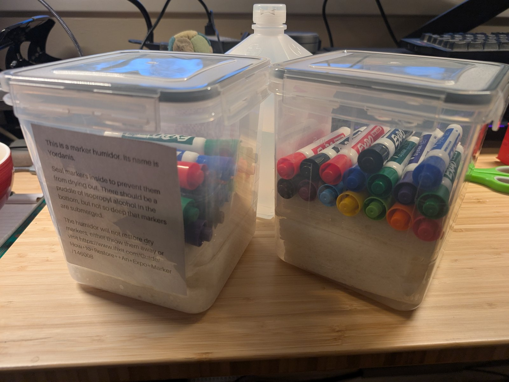
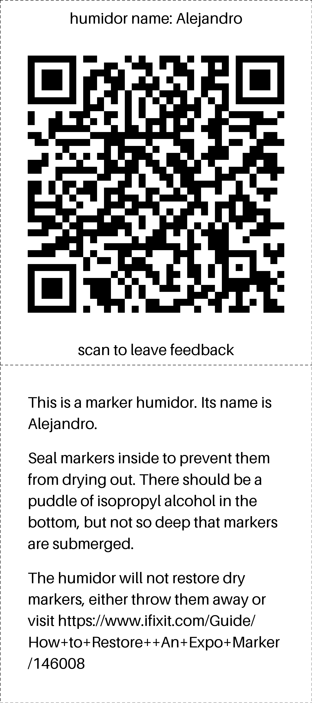
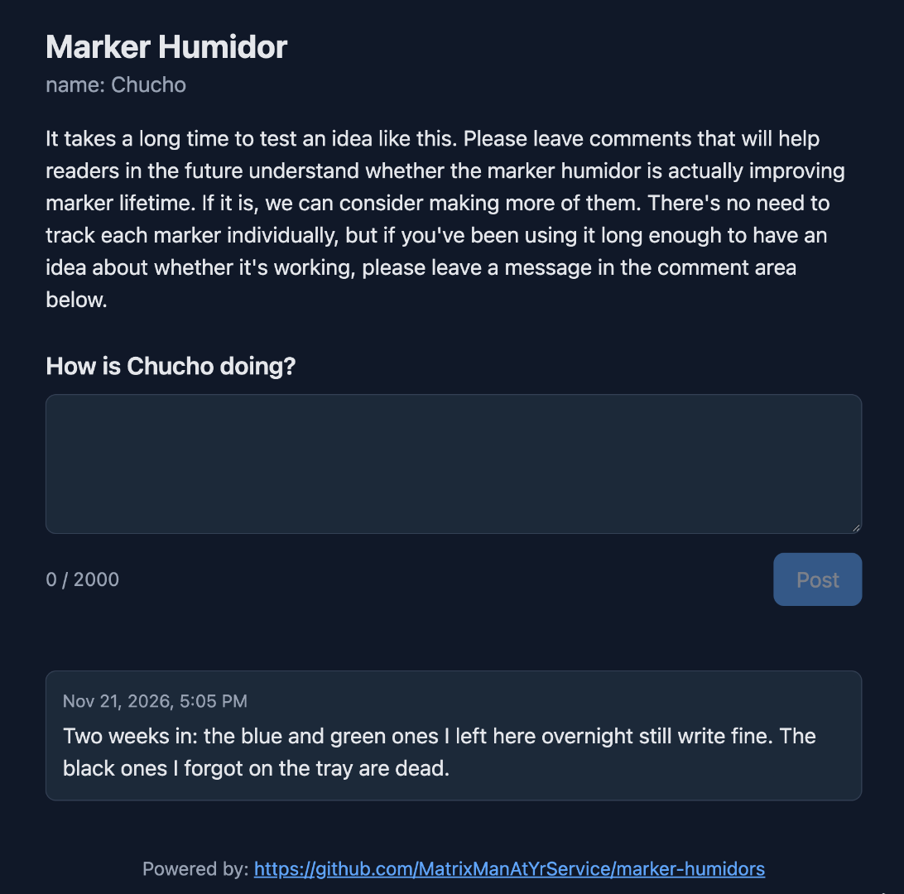

# marker-humidors

## 1. What's a marker humidor?

Dry-erase markers usually get thrown away because they dry out, long before their ink runs out. That happens fastest in dry climates.

A **marker humidor** is a lidded plastic container with a layer of sponges in the bottom.
The sponges are soaked in isopropyl alcohol.
Markers are stored on top of the sponges, not in the alcohol, and the sealed lid keeps the vapor in so they don't dry out.
The idea is that if people put markers back in the humidor after use, those markers will last much longer.

<p align="center">
  
</p>

This repo exists for creating labels and QR codes which point to a feedback page which is unique to each humidor.
That way we can learn if they're helpful or not, or how future designs should be different.

Each humidor gets a printable sheet like this, with two cards to cut apart and tape to different sides of the box:

<p align="center">
  
</p>

Scanning the code opens that humidor's page:

<p align="center">
  
</p>

This repo provides `humidor`, a command-line tool that:
- draws printable sheets like the one above;
- sets up the feedback pages on [Unison Cloud](https://unison.cloud), one per humidor;
- manages them afterwards, from reading and moderating comments to retiring humidors.

The pages need no accounts and take text only, up to 2000 characters. Each browser tab gets a random identity, so people can edit or delete what they just wrote but that identity is lost forever once they close that browser tab. Once a page is deployed, Unison Cloud serves it--the local server documented below is just useful while configuring it.

## 2. Get started: set up once, then ask your agent

If you have access to an AI coding agent like [Claude Code](https://claude.com/claude-code), it can create/edit/delete humidor feedback pages for you. To enable this:

1. **Create a [Unison Cloud](https://unison.cloud) account.** Your humidor pages will run there.
2. **Fork this repo and clone your fork.**
3. **Ask your agent to explore this repo.**
4. **Ask your agent to do something (creating new humidor? retiring an old one?  reading or moderating comments on an existing one?)

Depending on what they find on your machine, agents may need additional software.  Either of the following paths will do.

- **Install [nix](https://nixos.org/download)** and use `nix develop` to run commands as documented below

```bash
cd marker-humidors
nix develop
humidor serve
```


- Install [uv](https://docs.astral.sh/uv/) and [ucm](https://www.unison-lang.org/docs/install-instructions/) 1.5 or later, then put `./uv_run.sh` in front of every command.

```bash
./uv_run.sh humidor serve
```

## 3. Logging in to Unison Cloud

The humidor server works on Unison Cloud as you, so it needs your Unison Cloud login. Do this step yourself, not through your agent: it creates a key to your whole account.

In the repo, run `ucm` (inside `nix develop`, or the `ucm` you installed), and at its prompt:

```
auth.login
```

Follow the sign-in steps it shows, then type `exit` to leave ucm.

The login is saved in `~/.local/share/unisonlanguage/credentials.json`. Anyone who can read that file controls your Unison Cloud account, so make it private:

```bash
chmod 600 ~/.local/share/unisonlanguage/credentials.json
```

You only need to do this once per machine. If your agent ever reports `Action required: ... auth.login`, this is the step it means. To check, run `humidor check` (with the server running): "logged in to Unison Cloud" and "login file private" should both say `"ok": true`.

## 4. Working with your agent

Use two terminals, both in the repo:

1. **Yours: run the server** (`humidor serve`, as in section 2) **and keep it where you can see it.** Anything that would change a page or a comment pauses here, shows you what will change, and waits for you to type `yes`. Nothing else, your agent included, can approve on your behalf.
2. **Your agent's.** Start the agent here, inside `nix develop` if you went the nix route:

   ```bash
   nix develop
   claude               # or any agent that can run shell commands
   ```

The repo's `CLAUDE.md` and its `humidor` skill teach the agent the commands and the rules: use only `humidor` commands, say what will change before asking for approval, and stop when you say no. Then say what you want, in your own words:

> Point the page footer at my fork, github.com/YOU/marker-humidors.

> Set up a humidor called Chucho and tell me where its printable sheet is.

> Summarize the feedback on all my humidors. Is there evidence they make markers last longer?

> Someone posted the same junk three times on Chucho. Remove it.

> Is everything up? Check all the humidors.

> Reword the intro paragraph to ask how many weeks people have been using it. Try it locally first, then roll it out.

When the agent asks for something that changes a page, approve it in the server terminal. Reading things, like comments or whether pages are up, never needs approval.

**Printing:** each humidor's printable sheet is written to `qr/`. Print the `.pdf` at **100% / actual size** (not "fit to page"), cut along the dashed lines, and tape one card to each of two sides of the box.

**When you're done,** stop the server with Ctrl-C. Your pages stay up; the server is only needed while you're making changes or reading comments as admin.

<details>
<summary><b>What an approval prompt looks like</b></summary>

```
========================================================================
humidor: approval requested for CREATE
------------------------------------------------------------------------
  humidor      Chucho  (service marker-humidor-chucho)
  services     1 in the account now, 2 after
  git HEAD     3f2a91c0d4e1
  page link    https://github.com/MatrixManAtYrService/marker-humidors
  definitions
      markerHumidor.deploy : Text -> Text -> Text -> Text ->{Exception, Cloud} ServiceHash HttpRequest HttpResponse
      ...
------------------------------------------------------------------------
full source (nothing deployed yet):
...
========================================================================

Approve create? Type 'yes' within 300s:
```

The question is at the very bottom, after the details, so scroll down if you don't see it. It waits five minutes. Anything other than `yes`, or silence, cancels the request, and the agent is told it was denied.

</details>

<details>
<summary><b>How safe is it to let an agent do this?</b></summary>

- The `humidor` commands never hand out a secret, and approval can only come from the server's terminal. So an agent that sticks to them can't change anything without you.
- The agent still runs as you, on your machine, so it could read the login and token files directly. `CLAUDE.md` tells it not to, and you can block those paths in your agent's permission settings. Neither is a hard guarantee.
- For a real wall, run `humidor serve` as a different user or on another machine, and set `HUMIDOR_SERVER_URL` in the agent's shell. The agent's side then holds no secrets at all.

</details>

## 5. Commands

These are the commands your agent runs for you; you don't need to learn them. If you'd rather run them yourself, use a second terminal while `humidor serve` is running (with `./uv_run.sh` in front of each one if you didn't use nix). Every command prints JSON and has `--help`. Start with `humidor check`: it lists anything still missing from your setup, each with a fix.

| Command | What it does | Asks you first? |
|---|---|---|
| `humidor create NAME` | Set up a page for a new humidor and write its printable sheet | yes |
| `humidor qr NAME` | Draw a humidor's printable sheet again | no |
| `humidor ls` | All humidors, their URLs, and whether each is live | no |
| `humidor comments NAME` | Read a humidor's comments | no |
| `humidor edit NAME ID "TEXT"` | Replace a comment | yes |
| `humidor rm NAME ID` | Delete a comment | yes |
| `humidor verify [NAME...]` | Test that each page is live and correct | no |
| `humidor deploy` | Update every humidor with the current code and settings | yes |
| `humidor delete NAME` | Back up and remove a humidor and its comments | yes |
| `humidor adopt NAME` | Take charge of an existing humidor from this machine, with a new admin token | yes |
| `humidor check` | Setup problems, each with a fix | no |
| `humidor serve` | Run the server (you, in a visible terminal) | n/a |

**Names** can be up to 40 letters, digits, spaces and `.,'()-`. A name identifies the box, not where it sits, so moving a humidor needs no change. The page shows the name exactly as typed, and its URL uses a lowercase form: "Big Blue (2)" is served at `marker-humidor-big-blue-2`. Every command accepts either form.

<details>
<summary><b>Add a humidor and print its cards</b></summary>

```bash
humidor create Chucho
```

Approve it in the server terminal. Once it's deployed, the output includes the page URL and where its printable sheet was written:

```json
{
  "status": "created",
  "label": "Chucho",
  "url": "https://YOUR-ACCOUNT.unison-services.cloud/s/marker-humidor-chucho/",
  "sheet": {"print": "qr/marker-humidor-chucho.pdf", "image": "qr/marker-humidor-chucho.png"},
  ...
}
```

Print **`qr/marker-humidor-chucho.pdf`** at 100% (also called "actual size"; don't use "fit to page"). It's one page that fits Letter or A4, with a sheet 105 mm wide in the top-left corner, holding two cards with dashed cut lines:
- **QR card:** the humidor's name, the QR code, and "scan to leave feedback";
- **message card:** what a marker humidor is and how to use it.

Cut them apart and tape each to a different side of the humidor. Then scan the code with your phone and leave a test comment.

The `.png` is the same sheet as an image, for screens. Don't print it directly: most browsers and image viewers ignore its print size, and it comes out several times too big.

The message comes from `card_message` in `humidor.toml`, where `{name}` becomes the humidor's name. Lines join into paragraphs, and a blank line starts a new one. After changing it, `humidor qr NAME` redraws a sheet. A humidor's URL never changes, so redrawn or old cards keep working.

</details>

<details>
<summary><b>Read the feedback</b></summary>

```bash
humidor comments Chucho     # newest first
```

```json
{
  "comments": [
    {
      "id": "1795304737677-cfa4f84b",
      "text": "Added 3 blue markers. Tossed a black one with a split tip.",
      "createdAt": 1795304737677,
      "editedAt": null,
      "mine": true,
      "owner": "4c1e9a02"
    }
  ],
  "maxChars": 2000
}
```

- `createdAt` and `editedAt` are milliseconds since 1970 (UTC).
- `owner` is a short fingerprint of the browser tab that posted the comment. Comments sharing one came from the same person in one sitting, which helps when cleaning up spam.
- `mine` is always `true` here, because you are reading as admin.

It works with [`jq`](https://jqlang.org/), e.g. `humidor comments Chucho | jq -r '.comments[].text'`.

</details>

<details>
<summary><b>Clean up comments</b></summary>

Use the comment `id` from `humidor comments`:

```bash
humidor edit Chucho 1795304737677-cfa4f84b "Added 3 blue markers."   # replace the text
humidor rm Chucho 1795304737677-cfa4f84b                             # delete it
```

The approval prompt shows the comment as it is now and as it would become, so you can check you picked the right one.

</details>

<details>
<summary><b>Check that everything is working</b></summary>

```bash
humidor verify              # every humidor
humidor verify Chucho       # just one
```

For each humidor, this checks:
- **registry:** Unison Cloud has a deployment assigned to its name;
- **ledger:** that deployment is the one you last deployed;
- **page and API:** both answer, at the humidor's normal URL and at the URL of that exact version.

It exits with status 1 if anything fails, so you can run it from cron.

`humidor ls` gives each humidor a `state`:

| state | meaning |
|---|---|
| `deployed` | live, and it is what you last deployed |
| `not-deployed` | nothing is live under its name |
| `drift` | something other than your last deploy is live; run `humidor verify` to see what |
| `unknown` | the server could not reach Unison Cloud (see `live_error`) |

`strays` lists `marker-humidor-*` services in your account that this machine doesn't know about, for example ones made on another computer. See `humidor adopt` below.

</details>

<details>
<summary><b>Update the pages</b></summary>

After changing the app in `unison/src/`, or `repo_url` in `humidor.toml`:

```bash
humidor deploy
```

One approval covers every humidor. The prompt shows the source diff since the last deploy. Comments are kept.

</details>

<details>
<summary><b>Retire a humidor</b></summary>

```bash
humidor delete Chucho
```

This removes the page and all its comments, and its QR card stops working. Before asking for approval, the server saves the comments to `~/.local/share/humidor/backups/marker-humidor-chucho-<time>.json`, and the prompt says where. You can later create a new humidor with the same name; it starts with no comments.

</details>

<details>
<summary><b>Manage from another machine, or replace a token</b></summary>

Each humidor has its own admin token, which `comments`, `edit` and `rm` need. The server generates it when the humidor is created and keeps it in `~/.local/share/humidor/` on that machine. It isn't in git, and it can't be read back out of Unison Cloud. So a second computer, even one logged in to the same Unison Cloud account, starts out unable to moderate your humidors; `humidor ls` there lists them as `strays`.

Your Unison Cloud login outranks the tokens, though: whoever holds it can redeploy a humidor with a new token. That's what `humidor adopt` does:

```bash
humidor adopt Chucho
```

After you approve it, the server:
- redeploys Chucho with the current code and a fresh token, keeping its comments;
- records it on this machine;
- writes its printable sheet.

Use it to:
- manage a humidor from a new computer;
- recover after losing `~/.local/share/humidor`;
- replace a token you think has leaked (adopting on the same machine swaps it).

Any other machine's copy of the old token stops working. To keep moderating from both, copy `~/.local/share/humidor/` from one machine to the other instead, and keep the copy private (`chmod -R go-rwx`).

Give the name as the page shows it ("Chucho"), so the heading keeps its capitalization.

</details>

<details>
<summary><b>Options and environment variables</b></summary>

- `create`, `qr` and `adopt` take `--qr-dir DIR` to write the sheet somewhere other than `./qr/`.
- `serve` takes `--port` (default 8100) and `--host` (default `127.0.0.1`).
- `HUMIDOR_SERVER_URL` points the other commands at a server that isn't on this machine.
- `HUMIDOR_HOME` (default `~/.local/share/humidor`) is where the server keeps its state.

</details>

## Reference

<details>
<summary><b>Troubleshooting</b></summary>

Exit codes: 0 ok; 1 a check failed, or the server isn't running; 2 you need to do something, or the command was mistyped (the message says which); 3 you said no, or the approval timed out; 4 another error.

| Message | What to do |
|---|---|
| `cannot reach the humidor server` | Start `humidor serve` in another terminal. (Your pages are fine; only management needs the server.) |
| `Action required: ... auth.login` | Log in to Unison Cloud on the server's machine; see [section 3](#3-logging-in-to-unison-cloud). |
| `Denied: no terminal to ask for approval` | The server was started without a terminal (e.g. with `&`). Restart it in a normal terminal window. |
| `Denied: timed out waiting for approval` | Nobody typed `yes` in the server terminal within 5 minutes. The question is at the bottom of a long prompt; scroll down. Run the command again. |
| A humidor is listed under `strays`, or `unknown_humidor` for one you know exists | It was made on another machine, or this machine lost its records. Run `humidor adopt NAME`. |
| `service_exists` when creating | Your account already has a service with that name, maybe from another machine (see `strays` in `humidor ls`). Pick another name, or `humidor adopt` it if it's yours. |
| The printed sheet is huge or spans two pages | Print the `.pdf`, not the `.png`, at 100% / actual size. |
| `humidor ls` shows `drift` | Something other than your last deploy is live. `humidor verify NAME` shows what differs; `humidor deploy` puts your version back. |
| A deploy fails with a type error | The code in `unison/src/` doesn't compile. Nothing was deployed. Run `pytest tests/test_ucm_programs.py` to see the error. |

Unison Cloud's free tier limits how many services you can run, and each humidor is one service. Check the current limits before creating many; `humidor ls` shows how many services your account has (`services_in_account`).

</details>

<details>
<summary><b>How it works</b></summary>

```
humidor <command>  --HTTP-->  humidor serve  --ucm-->  Unison Cloud  <--  people scanning QR cards
 (prints JSON)                 holds your login         marker-humidor-chucho
 you, or an agent              and admin tokens,        marker-humidor-big-blue
                               logs every request,      ...
                               asks before changes      (runs on its own)
 '--------- only needed while you're managing ---------'
```

- **The server is only for management.** Each page is a Unison Cloud service, with its own database, that runs on its own. The server is a permission-checked way to tell Unison Cloud what to run, and to talk to the pages as admin. Stopping it doesn't affect the pages.
- **The server holds the secrets:** your Unison Cloud login and the humidors' admin tokens. The commands talk to it over HTTP, so it can run on another machine (set `HUMIDOR_SERVER_URL`). Nothing that talks to it ever receives a secret.
- **Each humidor is its own Unison Cloud service,** with its own database and admin token. The server generates the token and keeps it in `~/.local/share/humidor/humidors/`, readable only by you. Admin requests, like reading comments as admin or editing them, go through the server, which adds the token.
- **Every deploy starts clean.** The server forks a base codebase, whose library versions are pinned in `unison/base.md`, loads `unison/src/*.u` from disk, and runs a small generated program. What gets deployed is always what is in the repo.
- **Privacy:** for each comment the app stores only the text, its times, and a SHA-256 of the browser tab's random key. It sets no cookies and logs nothing about visitors. Unison Cloud, as the host, may keep its own request logs.
- **Records:**
  - `./humidor_logs/`: one JSON file per request.
  - `~/.local/share/humidor/deployments.jsonl`: every deploy and delete.
  - `~/.local/share/humidor/backups/`: comments saved before a delete.

</details>

<details>
<summary><b>Development</b></summary>

The app is two Unison files:
- `unison/src/marker-humidor.u`: routes, storage, and the deploy and teardown functions.
- `unison/src/page.u`: the HTML page.

The `humidor` command is Python, in `humidor/`.

```bash
nix develop
pytest              # unit tests, plus typechecking the app with real ucm
nix flake check     # ruff + pytest (ucm tests skipped in the sandbox)
./steps.sh          # nix formatting and lint
```

To try a change without deploying, run it in Unison's local cloud and open it in a browser. `CLAUDE.md` has the steps, plus rules for AI agents working in this repo.

The page's API, for scripts:

| Route | |
|---|---|
| `GET /` | the page |
| `GET /api/comments`, `GET /api/comments/<id>` | read |
| `POST /api/comments` with `{"text": ...}` | create; needs an `X-Session-Key` header (32+ characters) |
| `PUT` / `DELETE /api/comments/<id>` | allowed for the session that wrote it, or the admin (`Authorization: Bearer <token>`) |

`markerHumidor.Comment` is stored data. Changing its fields breaks reading existing comments, so add a new type and migrate instead.

Unison gotchas found while building this:
- `Route.request.header` is case-sensitive, and browsers send lowercase header names. Match them case-insensitively (see `markerHumidor.header`).
- Once a route has matched the method and a path prefix, routes doesn't fall through to the next alternative. Use one route per method and prefix, and branch on `Parser.rest`.
- The JSON decoder mishandles `\u` surrogate-pair escapes, so send raw UTF-8. In Python that means `ensure_ascii=False`.
- `@unison/json` must be the version `@unison/routes` was built against, or their `Json` types won't match.
- The local cloud (`Cloud.main.local.serve`) exits when its stdin closes. Keep stdin open, e.g. `sleep 600 | ucm transcript.fork ...`.

</details>
